<!--
  PROFILE README for GitHub user: monicasenthil28
  Create a repository named exactly "monicasenthil28" and place this file as README.md.
-->

## Monica Senthilkumar

**AI & Data Science Student | Machine Learning Enthusiast | Problem Solver**

B.Tech student specializing in **Artificial Intelligence & Data Science** at  
**Sri Ramakrishna Engineering College, Coimbatore**.

Interested in machine learning, problem-solving, and applying technical skills through practical AI and data science projects.

[LinkedIn](https://www.linkedin.com/in/monicasenthilkumar) / [Email](mailto:nicasenthil28@gmail.com)

 

## 📈 Contribution Activity

  

## About

- Pursuing **B.Tech in Artificial Intelligence & Data Science**
- CGPA: **7.25**
- Programming with **C, C++, Python, and Java**
- Knowledge of **Artificial Intelligence, Machine Learning basics, and Machine Unlearning Techniques**
- Completed an **Artificial Intelligence internship**
- Completed a **1-month Web Development course**
- Interested in practical AI, ML, data science, and intelligent systems
- Member of the **Youth Red Cross Club** at Sri Ramakrishna Engineering College
- Languages known: **Telugu, Hindi**

## Featured Work

**AI-Driven Computer Vision Approach for Detection and Alert of Traffic Incidents to Fire Station**  
Team project focused on real-time traffic incident detection using computer vision, with an alert mechanism designed to quickly notify a fire station when an incident is detected.

**Real-Time Detection of Narcotics and Explosives across Indian Railways**  
Proposed a mobile quadruped / handheld system for real-time detection of narcotics and explosives, focused on improving security and screening across Indian Railways.

**AI-Enabled Smart Battery Management System**  
Developed an AI-enabled battery management concept with intelligent range prediction and charging-station recommendations to support efficient trip planning.

## Experience & Learning

**Artificial Intelligence Intern**
- Gained practical experience in AI concepts and real-world applications
- Applied programming and AI fundamentals to internship assignments

**Web Development Course**
- Completed a 1-month course in web development
- Applied programming and web development fundamentals through course assignments

## Education

**B.Tech – Artificial Intelligence & Data Science**  
Sri Ramakrishna Engineering College, Coimbatore  
Expected Graduation: **May 2028** | CGPA: **7.25**

**HSC (Class XII)**  
Vidyaa Vikas International School  
2023–2024 | **76%**

**SSLC (Class X)**  
Vidyaa Vikas International School  
2021–2022 | **86%**

## Certifications & Accomplishments

- **C++ Programming** — Infosys, 2024
- **Basics of Python** — Infosys, 2025
- **Cyber Security Fundamentals** — IBM SkillsBuild, 2026
- Member of the **Youth Red Cross Club**, Sri Ramakrishna Engineering College

## Focus

C / C++ / Python / Java / Artificial Intelligence / Machine Learning / Machine Unlearning / Computer Vision / Web Development / Problem Solving / Teamwork / Leadership

## Connect

- **GitHub:** [monicasenthil28](https://github.com/monicasenthil28)
- **LinkedIn:** [Monica Senthilkumar](https://www.linkedin.com/in/monicasenthilkumar)
- **Email:** [nicasenthil28@gmail.com](mailto:nicasenthil28@gmail.com)
- **Location:** Coimbatore, Tamil Nadu

---

**Learning, building, and improving one project at a time.**

